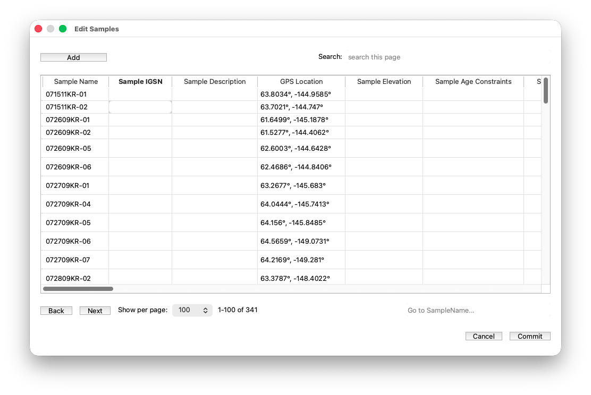

Viewing and editing metadata
============================

Viewing tables and trees
------------------------

The main window opens with the **Samples** table. Use the drop-down in the upper left to
switch tables.

* **Paging:** tables are paged for performance. Set the number of rows per page with the
  drop-down in the lower right. Hierarchical tables (trees) are not paged and may take
  longer to load in large databases.
* **Searching:** the search bar in the upper left searches every field on the current
  page. The search bar in the lower left searches item names and jumps to the matching
  page and row.
* **Sorting:** clicking a column header sorts the current page only.
* **Refreshing:** the refresh button in the upper left reloads the table to show recent
  changes.

Data are displayed in the units and formats chosen in the *Units and Formats* tab of
settings. Column visibility and order for Samples, Aliquots, Grains, Spots, UPbAnalyses,
Columns and References are set in the *Table Displays* tab (see :doc:`settings`).

To protect the database, data cannot be edited directly in the viewer. Click the edit
button to open a separate editing window. The Samples table has two extra options:

* **Edit Selected** opens the :doc:`Sample Information <sample_information>` window. You
  can also open it by right-clicking a sample and choosing **Edit**.
* **Edit Samples** opens table-style editing.

Right-clicking in a table gives options to add or edit entries. In hierarchical views,
you can also expand or collapse levels.

For samples, extra right-click options show the related aliquots, grains, spots and
analyses. These open in separate tabs and can be edited there too. Right-clicking an
aliquot, grain, or spot opens the items that depend on it.

Editing tables
--------------

   The edit window for the Samples table.

The edit window looks like the viewer but may show different columns, as set in
settings. **Add** in the upper left opens a dialog to add a new item.

* Double-click a text field, such as name or description, to edit it.
* Double-click a many-to-many tag field, such as contexts, to open a checkable drop-down.
  Right-click the drop-down list or tree to edit it.
* Double-click some fields, such as GPS values, to open a dedicated dialog that keeps the
  related GPS fields consistent.

Bulk editing
^^^^^^^^^^^^

To change several values in a column at once, select the cells, right-click, and choose
**Set selected values…**. The dialog that opens applies to every selected cell.

* In a checkable drop-down, a partially checked entry means it applies to only some of
  the selected items. Only fully checked or fully unchecked entries are applied to all of
  them.
* Cells can also be cleared by right-clicking.
* Fields that must be unique, such as name, can only be bulk-edited where the selected
  values share common text, and then only that common text can be edited.

Merging items
^^^^^^^^^^^^^

Select items, right-click, and merge them into one. Choose the item to keep; all links
from the other items are moved to it. For example, merging two samples moves all their
aliquots, grains, spots, analyses and sample tags to the sample you keep.

.. warning::

   Values stored directly on the removed items, such as description, GPS, or isotopic
   data, are lost.

Deleting items
^^^^^^^^^^^^^^

Select items and right-click to delete them.

* If selected samples, aliquots, grains or spots have dependent aliquots, grains, spots
  or analyses, you choose whether to delete those as well.
* If a selected metadata item (for example a lab facility) is linked to other items (for
  example U-Pb analyses), GeoCORK warns you that those links will be deleted too.

Savepoints: Commit and Close
^^^^^^^^^^^^^^^^^^^^^^^^^^^^

GeoCORK creates a savepoint when an edit window opens.

* **Close**, or the window's **X** button, asks you to confirm discarding changes and
  then returns the database to the savepoint.
* **Commit** saves your changes, releases the savepoint, and closes the window.

Each additional edit or add window you open creates its own savepoint. Changes are not
final until *every* open edit and add window has been committed. Discarding changes in
the first edit window also discards changes made in all the others.

Editing trees
-------------

* Double-click a text field, such as name or description, to edit it.
* Move items by selecting one or more and dragging them to the new position.
* Right-click to add an item as a parent, as a child, before or after a sibling, or at
  the end.
