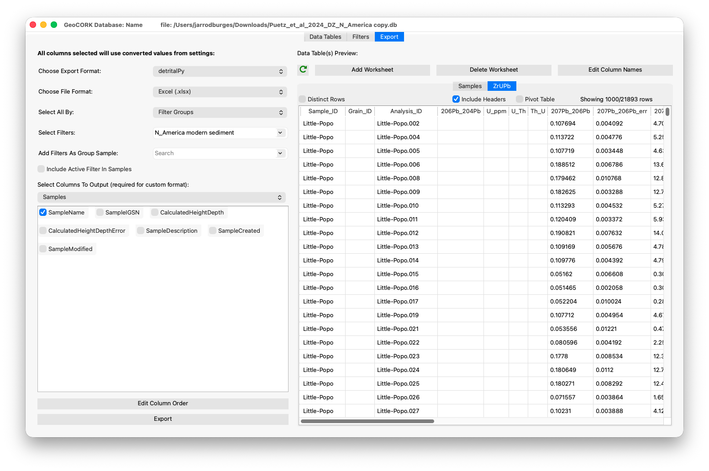

Exporting data
==============

   The Export tab with the detritalPy format and the ZrUPb sheet selected.

Export data to Excel or CSV from the **Export** tab of the main window. Several formats
for popular data tools are built in:

* detritalPy
* IsoplotR
* DZstats, DZmix, DZmds, DZnmf
* AgeCalcML Concordia
* GeoCORK database format

For these formats, age errors must be absolute, not percent (for example 1σ in Ma, not
Ma %). If your current settings don't match what the chosen format needs, GeoCORK offers
to change them. Your current unit and format settings are shown in the lower left.

Selecting data for export
-------------------------

Select by samples
   Check samples in the **Select Samples** drop-down. Right-click the drop-down to select
   or deselect all.

Select by samples, with filtered U-Pb data
   Narrow the selected samples further with saved filters from the **Select Additional
   Filters** drop-down, for example only accepted analyses, concordance limits, U/Th
   ratios, or contexts.

Select by filters
   Change the **Select all by** drop-down to **Filter Groups**, then check the filters
   to use. Selecting several filters gives the union of their results: if filters A, B
   and C select U-Pb data X, Y and Z, the export contains X ∪ Y ∪ Z.

Add filters as group sample
   Each checked filter is exported as a single "sample" named after the filter. Use this
   to export a compilation as one item. It can be combined with selected samples or
   filters.

Active filter
   When **Active Filter** is checked, it overrides all other selection criteria and uses
   the filter currently in the Filters tab. This is the quickest way to try different
   filters, export, and plot.

Export preview
--------------

Once a format and data are selected, the right-hand table previews the first 1000 rows of
the export. For the **Database** format, the preview is replaced by the Data Viewer, with
items and their attributes side by side.

Custom export formats
---------------------

For full control, choose **Custom** from the **Choose Export Format** drop-down.

File format
   Choose ``.xlsx`` or ``.csv`` from the **Choose File Format** drop-down.

Fields
   Below the sample and filter selection on the left, choose a table from the drop-down
   and check the fields to export. Fields become columns in the order you check them. You
   can reorder and rename columns afterwards (see *Export display* below).

   Some fields come in *Display*, *Calculated*, or *Converted* variants. In the GPS
   Locations table, for example:

   * **GPSLocationConverted**: latitude and longitude combined, with directions,
     converted to the GPS format in your settings.
   * **GPSLocationDisplay**: latitude and longitude combined, with directions, in the GPS
     format used when the data were entered.
   * **CalculatedLatDisplay**: the latitude fields combined, with direction, converted to
     the GPS format in your settings.

   The U-Pb analysis table also has:

   * **CalculatedBestAge**: the analysis's best age, converted to the age unit in your
     settings.
   * **CalculatedBestAgeFilled**: the best age, or the age chosen in settings to fill an
     empty best age, converted to the age unit in your settings.

Worksheets
   The exporter supports multiple worksheets. **Add Worksheet** adds a sheet to the left
   of the current ones, and double-clicking a sheet tab renames it. The selected samples
   and filters apply to every sheet, but each sheet can show different fields.

Export display
   * **Edit Column Order**, below the field checkboxes, reorders the columns.
   * **Edit Column Names**, in the upper right, changes the column display names.

   Below the worksheet tabs are three checkboxes:

   * **Distinct Rows**: by default each row is one analysis, so exporting only sample
     fields can repeat a sample once per analysis. Distinct Rows collapses these
     duplicates.
   * **Include Header**: writes the column names as the first row.
   * **Pivot Table**: some formats, such as the DZ suite, expect a repeating group of
     columns for each sample (Sample 1 Age, Sample 1 Age Error, Sample 2 Age, Sample 2
     Age Error, …). Make the first column the sample (or grouped filter) name; every other
     column is then repeated for each sample, prefixed with the sample name.

Exporting
---------

When the data are ready, click **Export** in the lower left and choose a location and file
name.

* ``.xlsx`` and ``.csv`` exports open automatically in your computer's default application
  so you can check them.
* For the **Database** format, a File Explorer or Finder window opens at the exported
  file. To open it, close the main window to return to the landing page, then open the
  new ``.db`` file.
