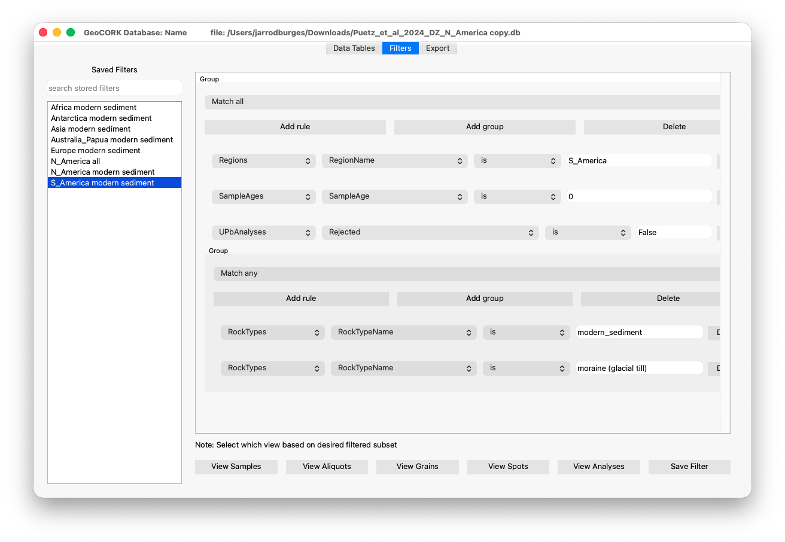
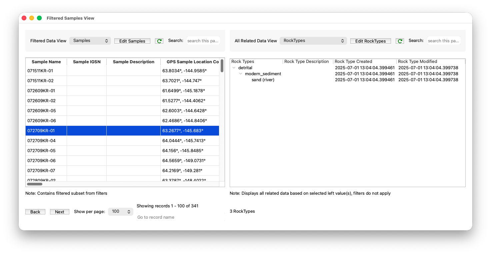
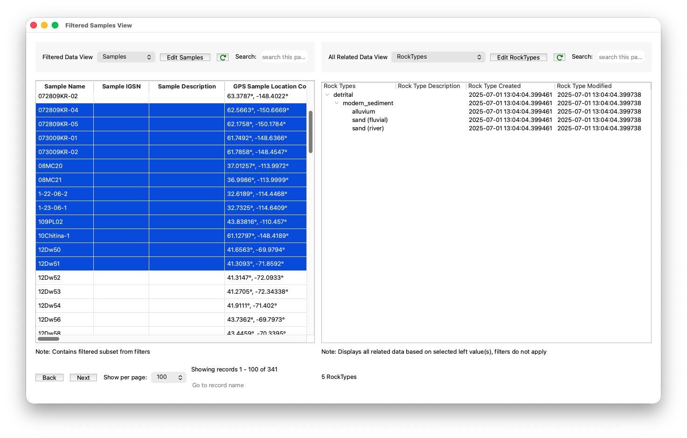

Filtering data
==============

   The Filters tab.

Create, edit and save filters in the **Filters** tab. A filter is a query built from
rules and nested groups of rules, with no limit on complexity. Each group can match
*all*, *any*, or *none* of its conditions.

A saved filter stores the query, not its results, so its results always reflect the
current database. Double-click a saved filter to reuse it. Results can be viewed at any
level: samples, aliquots, grains, spots or analyses.

Building a query
----------------

A **filter rule** is a single criterion. First choose the table, then the attribute in
that table. The available qualifiers depend on the type of attribute.

Numerical rules
^^^^^^^^^^^^^^^

For numerical data such as U-Pb data, direct ages, isotope data, concentrations,
distances and sizes.

For ranges, enter two values separated by a comma, such as ``1.0,2.0``. Their order does
not matter.

* is equal to
* is not equal to
* is greater than
* is less than
* is between
* is not between
* is blank
* is not blank

Categorical rules
^^^^^^^^^^^^^^^^^

For text fields such as Units, Rock Types and Regions.

* is equal to
* is not equal to
* starts with
* ends with
* contains
* does not contain
* is blank
* is not blank

Calendar rules
^^^^^^^^^^^^^^

For the **Created** and **Modified** attributes that every table has. These help you
quickly find and edit recently imported or changed data.

For ranges, enter two dates separated by a comma, such as ``2025-01-01,2025-12-31``.
Their order does not matter.

* is on
* is not on
* is after than
* is before than
* is between
* is not between

Grouped rules
^^^^^^^^^^^^^

Rules can be combined in a **grouped rule**, and groups can be nested for complex
filtering. A group combines the results of its rules in one of three ways:

Match All
   Returns the intersection of the rules' results.

Match Any
   Returns the union of the rules' results.

Match None
   Returns the inverse intersection of the rules' results.

Saving a filter
---------------

With a query in the builder, click **Save Filter** in the lower right and enter a name and
description.

* The name appears in the left column of the Filters tab, and the description appears
  when you hover over it.
* Filter names must be unique.
* Filters are listed alphabetically and can be deleted by right-clicking.

Double-click a name in the left column to load that filter. If you click **Save Filter**
while a saved filter is loaded, GeoCORK asks whether to update it or save a new filter.
This lets you edit an existing filter or use it as the starting point for a new one.

Viewing a filter's results
--------------------------

With a query in the builder, you can view its results. Because GeoCORK stores data
hierarchically from samples down to U-Pb analyses, you can view results at any level:

View Samples
   Samples that match the criteria, or that are linked to aliquots, grains, spots or
   analyses that match.

View Aliquots
   Aliquots that match the criteria, or that are linked to samples, grains, spots or
   analyses that match.

View Spots
   Spots that match the criteria, or that are linked to samples, aliquots, grains or
   analyses that match.

View U-Pb Analyses
   U-Pb analyses that match the criteria, or that are linked to samples, aliquots, grains
   or spots that match.

.. note::

   If a filter sets conditions on U-Pb data but you view samples, a sample is included
   when even one of its U-Pb analyses matches. This is intended, and it is why results
   can be viewed at each level of the hierarchy.

The Data Viewer
^^^^^^^^^^^^^^^

   The Data Viewer.

The window opened by a **View …** button is the **Data Viewer**. It is useful for editing
many items at once and for checking filter results before exporting.

The Data Viewer has two tables:

* The **left table** holds the filtered data. The drop-down above it switches the
  hierarchy level.
* The **right table** shows a metadata table (such as Rock Types, Units or Spot Contexts),
  chosen with the drop-down above it.

The right table follows your selection on the left. For example, with Rock Types on the
right, selecting one or more rows on the left shows only the rock types associated with
them. This makes it quick to see what is linked to any data point.

   Selecting rows on the left updates the right table.

* Editing the **left table** opens an edit window with every item that passes the filter,
  which makes filter-then-bulk-edit easy.
* Editing the **right table** opens an edit window with every item in that table, whether
  or not it is linked to the filtered items.

Several Data Viewer windows can be open at once to compare different filters. However,
refreshing any of them reapplies whatever filter is *currently* in the Filters tab, not
the filter that was active when the window opened.
