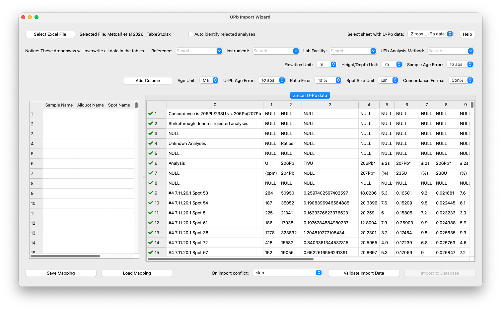

Importing data
==============

Open the Import Wizard from the main toolbar with **File → Import**, or press :kbd:`Cmd+I`
(:kbd:`Ctrl+I` on Windows and Linux).

   The Import Wizard with zircon U-Pb data from Metcalf et al. (2026).

Input requirements
------------------

Check the following before importing:

* Only ``.xlsx`` files can be imported.
* Use one field per column. Split combined values, such as age ± error or GPS in DMS,
  into separate columns.
* Names must be unique across the database.
* Every analysis needs a column for analysis name, spot name, or grain name, *and* a
  column for aliquot name or sample name.
* Hierarchical (parent-child) data are currently all imported as top-level items.
  Organize parent-child relationships after importing.
* Only one non-hierarchical item can be imported per operation. For example, suppose a
  sheet has maximum depositional ages from several methods. First import the best age,
  which becomes the default age. Then change the mapping and import the next set of ages
  for the same samples.

Selecting the file
------------------

Choose the ``.xlsx`` file to import. It can contain multiple sheets, for example sample
metadata on one sheet and U-Pb data on another. A prompt asks which sheet contains the
U-Pb data.

Large spreadsheets load more slowly, so splitting them into smaller files is recommended.
Empty cells appear as ``NULL``.

Mapping columns
---------------

Double-click a column header to open the column mapper. Its tabs group the database
fields by category:

* Sample Info
* GPS Info
* Column Info
* Aliquot/Spot/Grain Info
* Reference
* U-Pb Data

Each drop-down auto-completes, which helps you find values in long lists.

* To change a mapping, double-click the header and choose a different field.
* To unmap a column, choose **None**.
* You can map duplicate columns for hierarchical parent-child data, but all entries are
  still imported as top-level items.

Header colors show each column's mapping state, and columns can be remapped or unmapped
at any time:

.. list-table::
   :header-rows: 1
   :widths: 25 75

   * - Header color
     - Meaning
   * - Green
     - Mapped
   * - Blue
     - Mapped and saved
   * - Gray (shows a number)
     - Unmapped; the column will be ignored

Sheet-wide metadata
^^^^^^^^^^^^^^^^^^^

The top four drop-downs (**References**, **Instruments**, **Lab Facilities** and **U-Pb
Analysis Methods**) apply to every row of the U-Pb sheet, so each takes one value.

* Right-click a drop-down to change the values it offers.
* Choosing a value adds a column filled with that value and puts the field name in its
  header, which stays gray.
* To remove one of these columns, uncheck it.

The two lower rows of drop-downs set fixed database values, such as units and data
formats. They are filled from your current settings, but you can change them to match the
file being imported. These drop-downs do not add columns to the sheet, but their values
are saved with the column mapping.

Saving and loading mappings
^^^^^^^^^^^^^^^^^^^^^^^^^^^

A mapping covers every sheet plus the fixed fields, and it is saved as a JSON file.

Save Mapping
   Name a new mapping or overwrite an existing one.

Load Mapping
   Reload a saved mapping.

Editing data in the importer
----------------------------

You can edit data directly in the importer, but editing in Excel (or another program)
keeps a record of your changes and is usually better.

* Double-click a cell to edit it.
* To set several cells at once, select them, right-click, and choose **Set selected cells
  to value…**.
* To edit a whole column, right-click its header and choose **Set entire column to
  value…** or **Set entire column to blank…**.
* Remove rows or columns by right-clicking.
* Add columns with the **Add column** button, or right-click and choose **Insert column
  before** or **Insert column after**.

.. warning::

   Adding or removing columns can stop a saved mapping from working with future imports.

The U-Pb data sheet
-------------------

On the U-Pb data sheet, an extra table on the left has columns for **Sample Name**,
**Aliquot Name**, **Spot Name** and **U-Pb Analysis Name**, plus **Grain Name** if a grain
column is mapped in the right-hand table. When you map a name column on the right, its
values fill the matching column on the left.

At minimum, fill in:

* **Sample Name** or **Aliquot Name**, and
* **Grain Name**, **Spot Name**, or **U-Pb Analysis Name**.

The other name fields can be given default values derived from the ones present.

The hierarchy is strict: each U-Pb analysis belongs to one spot, each spot to one
aliquot, and each aliquot to one sample.

Accepted, rejected and disabled rows
------------------------------------

To change the state of rows, select them and right-click.

Accepted
   The default, shown by a green checkmark. The row is imported.

Rejected
   U-Pb data sheet only. Double-click the checkmark to change it to a red circle with a
   line through it, and double-click again to accept the row. Rejected rows *are*
   imported, but they are flagged as rejected in the database.

Disabled
   Not imported at all. You can either delete rows you want to skip or disable them so
   they stay visible.

Validating the import data
--------------------------

After mapping, run **Validate Import Data**. Validation checks for:

* **Empty cells** in the left (U-Pb names) table. These are highlighted in red, and you
  are asked whether to apply default values. Filled-in defaults are highlighted in purple
  for you to review.
* **Duplicates with conflicting parents** in the left table, highlighted in red.
* **Possible duplicates of existing samples, aliquots, grains, spots and U-Pb analyses**
  already in the database, highlighted in yellow.
* **Missing key fields.** Related data cannot be mapped without the identifier they
  belong to; for example, sample GPS data need a sample name.

Fix every red cell before continuing. Once the data pass validation, the import button
becomes active.

Conflict resolution mode
------------------------

The drop-down at the bottom center sets how conflicts with items already in the database
are handled:

Skip
   Ignore the incoming item and keep the existing data.

Add to
   Add new data without overwriting any existing values. For example, column information
   can be added to a sample that lacked it while its other fields stay unchanged.

Overwrite
   Remove the existing data and replace it entirely with the imported data.

Importing
---------

Before importing, GeoCORK runs validation again in case anything changed since the last
check. If it passes, the import proceeds.

* If formatting problems or unresolvable conflicts are found during the import, the cells
  involved are highlighted, an error message is shown, and the import is cancelled so you
  can fix them.
* You can cancel at any time with **Cancel** in the progress window.
* When the import succeeds, the Import Wizard closes and you return to the main window.
