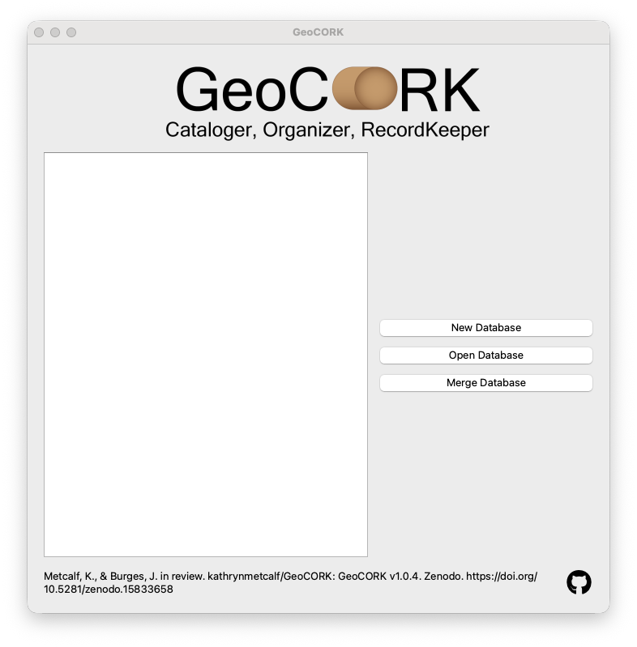
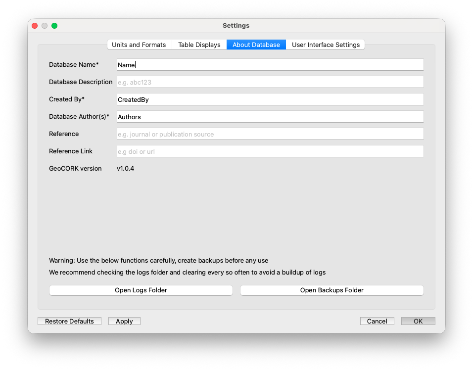

Landing page
============

   The landing page.

When GeoCORK launches, the first window is the **landing page**. It is the only way into
the rest of GeoCORK and has three buttons: **New Database**, **Open Database** and
**Merge Database**. The citation at the bottom links to GeoCORK's DOI, and the GitHub
logo opens the GeoCORK GitHub page.

Opening an existing database
----------------------------

Click **Open** to open a file selector, then navigate to the ``.db`` file and open it.
Previously opened databases are listed on the left: double-click one to open it, or
select it and click **Open**.

Creating a new database
-----------------------

Click **New** to open a file creator prompt, choose a location, and enter a file name.

   The About Database dialog shown when a database is created.

After the database is created, an optional dialog asks for its metadata:

* Database Name
* Database Description
* Created By
* Database Author(s)
* Reference
* Reference Link

You can change all of these later in **File → Settings/Preferences**, on the
:ref:`About Database <settings-about-database>` tab.

Merging two databases
---------------------

**Merge Database** combines two GeoCORK databases. See :doc:`merging`.
