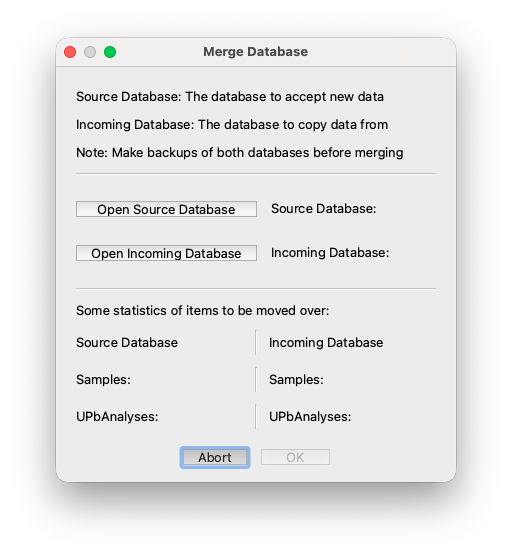

Merging databases
=================

.. important::

   Back up both databases before merging, using **File → Create Backup** in the main
   window.

   The merge dialog.

Start a merge with **Merge Database** on the :doc:`landing page <landing_page>`.

* The **Source Database** receives the merged data.
* The **Incoming Database** contains the data to be added or merged in.

Summary statistics at the bottom of the dialog show how many Samples and U-Pb analyses
will be merged.

During a merge, items in the two databases may have the same name. GeoCORK resolves these
conflicts by appending "(1)" and "(2)" to the names. Afterwards, review those items in
GeoCORK and clean them up.

Close both database files in any other application before merging.
