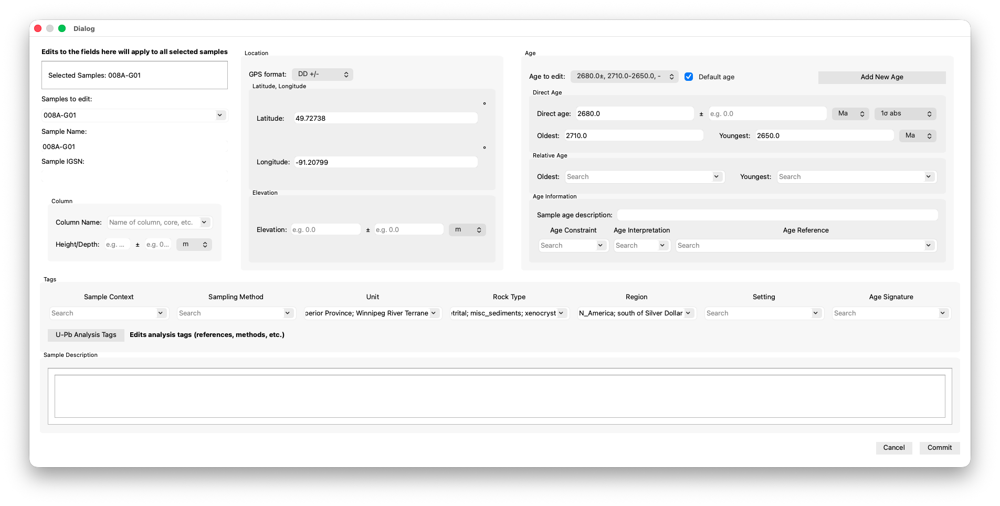

Sample Information window
=========================

   The Sample Information window.

The Sample Information window edits metadata for one or more samples. To open it:

1. In the main window, make sure **Samples** is selected in the main drop-down.
2. Select one or more samples.
3. Click **Edit Selected** at the top, or right-click and choose **Edit**.

When several samples are selected, fields whose values differ between them show a dash
(``-``).

Selected samples
----------------

All samples chosen for editing appear in a checkable drop-down in the upper left. The
samples checked there are the ones your edits change. Right-click the drop-down to
select, deselect, or delete samples.

With several samples selected, unique fields such as sample name and IGSN are disabled.
Editing any other field overwrites that value on every selected sample. Many drop-down
fields can be customized by right-clicking.

Column information
------------------

Samples can be linked to stratigraphic columns, cores, wells and similar structures. Add
new columns through the drop-down. Height or depth values can be positive or negative but
must always have units.

GPS
---

GPS coordinates can be entered in several formats, and the visible fields change with the
selected format. Entries are checked when you leave the group of GPS fields. Elevation
values must have units.

The available formats are:

* DD +/-
* DD NSEW
* DDM +/-
* DDM NSEW
* DMS +/-
* DMS NSEW
* standard UTM

Sample ages
-----------

A sample can have several ages. You can add a combination of:

* a direct age value (error optional),
* a direct age range, or
* a relative age range.

Units are required wherever they apply. If several samples are selected, the same age is
assigned to all of them, and GeoCORK warns you first.

Existing age records can be reused across samples. Further fields let you specify age
constraints, interpretations and references.

Tags
----

Several kinds of tags are edited from drop-downs. Tags can be checked or partially
checked (a line instead of a full check). U-Pb analysis tags open in a separate window,
where analysis-level information is edited and applied to every analysis in the sample.

Sample description
------------------

A text box for general notes or descriptive information about the samples.
