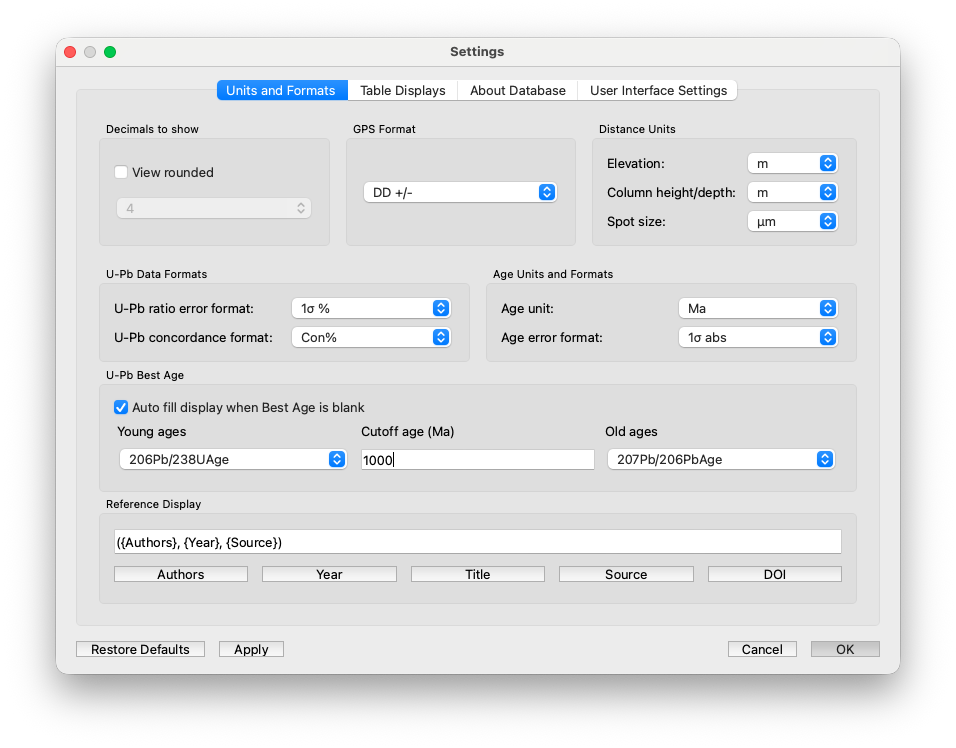
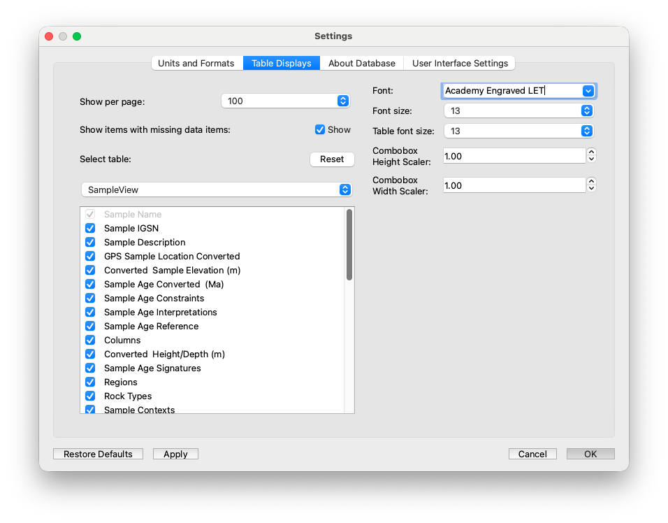

Settings and preferences
========================

Open settings from the toolbar or with :kbd:`Cmd+,` (:kbd:`Ctrl+,` on Windows and
Linux). Display settings are stored for GeoCORK as a whole, not per database, so every
database you open shares the same display settings.

* **Apply** saves your changes.
* **OK** saves and closes.
* **Cancel** discards your changes and closes.
* **Restore Defaults** returns every setting to GeoCORK's defaults.

Changing a display setting never changes stored data. Values are converted on the fly
for display and export.

Units and Formats
-----------------

   The Units and Formats tab.

Decimals To Show
   A checkbox turns rounding on or off, and a drop-down sets how many decimals to show.

GPS Format
   Switches between the available GPS formats. Stored GPS data are not changed. Every
   table or display with GPS data is converted on the fly to this format.

Distance Units
   Three drop-downs for the displayed distance units:

   * **Elevation**, used for GPS metadata.
   * **Column height/depth**, used in the Samples table.
   * **Spot size**, the diameter of a laser-ablation pit on a grain.

U-Pb Data Formats
   * **U-Pb ratio error format**: the error shown for isotope ratios (for example
     ²⁰⁷Pb/²³⁵U ± 2σ %). The options are 1σ absolute, 2σ absolute, 1σ percent and
     2σ percent.
   * **U-Pb concordance format**: Concordance, Concordance Percent, Discordance, or
     Discordance Percent.

Age Units and Formats
   * **Age unit**: the unit used to display ages in Samples, Sample Ages and U-Pb data.
   * **Age error format**: 1σ absolute, 2σ absolute, 1σ percent, or 2σ percent.

U-Pb Best Age
   Fills blank best-age values when data are displayed or exported. The blanks in the
   database are not overwritten. There are three entries: the young age, the cutoff age
   (Ma), and the old age. By default, the best age is the ²⁰⁶Pb/²³⁸U age when that age is
   below 1000 Ma, and the ²⁰⁷Pb/²⁰⁶Pb age otherwise.

   The available ages are ²⁰⁶Pb/²³⁸U, ²⁰⁷Pb/²³⁵U, ²⁰⁷Pb/²⁰⁶Pb and ²⁰⁸Pb/²³²Th.

Reference Display
   A line edit that builds how references are shown. The **Authors**, **Year**,
   **Source** and **DOI** buttons insert the matching fields from the References table.
   Any other text you type appears in every reference display. Changing this field updates
   how references are displayed but changes nothing in the database.

Table Displays
--------------

   The Table Displays tab.

This tab controls how tables are displayed, including font sizes, scalers and column
selection.

Show per page
   How many rows each page of a table shows: 10, 25, 50, 100, 250, 500, or 1000. Tables
   open with this number, and you can still change it in the table view.

Show items with missing data
   Controls whether items missing a level below them in the data chain (Samples →
   Aliquots → Grains → Spots → U-Pb Analyses) are shown, such as a sample with no U-Pb
   analyses.

   * **On**: such items are visible. GeoCORK uses ``LEFT`` joins instead of most
     ``INNER`` joins, which joins more data and can be slower for large databases.
   * **Off**: faster for large databases, but such items do not appear in table displays,
     only in drop-down lists.

Table Views
   Choose a table from the drop-down, then use the checkboxes to show or hide its columns.
   Drag rows to change the column order. The editable views are Samples, Columns,
   Aliquots, Grains, Spots, U-Pb Analyses and References, plus their *Edit View* variants.
   **Reset** restores GeoCORK's default columns for the selected table only.

Font, Font Size and Table Font Size
   **Font** applies to all text in GeoCORK. **Font size** changes all text outside
   tables, and **table font size** changes text inside table cells.

Combobox Height/Width Scalers
   These rarely need changing. On some screen setups, drop-downs may look cut off or very
   small. Values above 1.0 enlarge them.

.. _settings-about-database:

About Database
--------------

This tab holds the database metadata entered when the database was created (see
:doc:`landing_page`). Two buttons at the bottom open GeoCORK's support folders:

Open Logs Folder
   Opens a File Explorer or Finder window with one log file per GeoCORK session. The
   newest file belongs to the current session. If you run into a problem, the log files
   help the GeoCORK team find and fix it (see :doc:`troubleshooting`).

Open Backups Folder
   Opens a folder with one subfolder per database file name, each holding time-stamped
   backups of that file.

.. tip::

   Back up your databases regularly with **File → Create Backup**. Restore a backup in
   GeoCORK with **File → Restore Backup**, or directly from the backups folder.

User Interface
--------------

Tooltips are the hints that appear when you hover over an item. If you find them
distracting, you can turn them off here.
